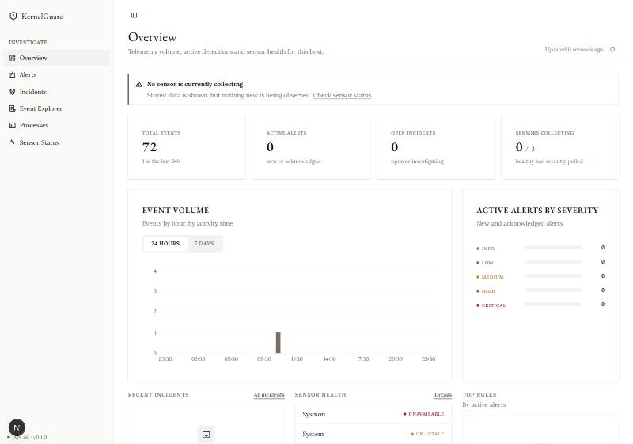
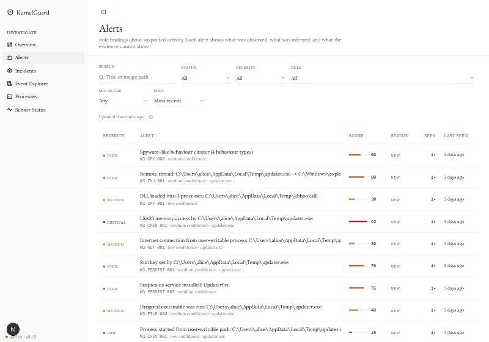
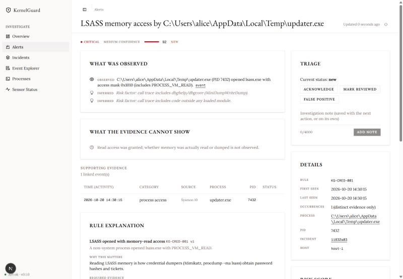
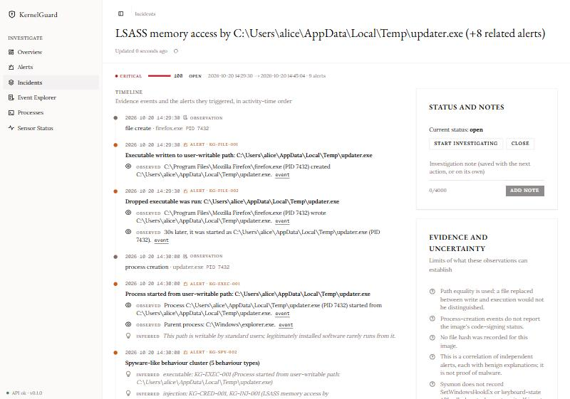
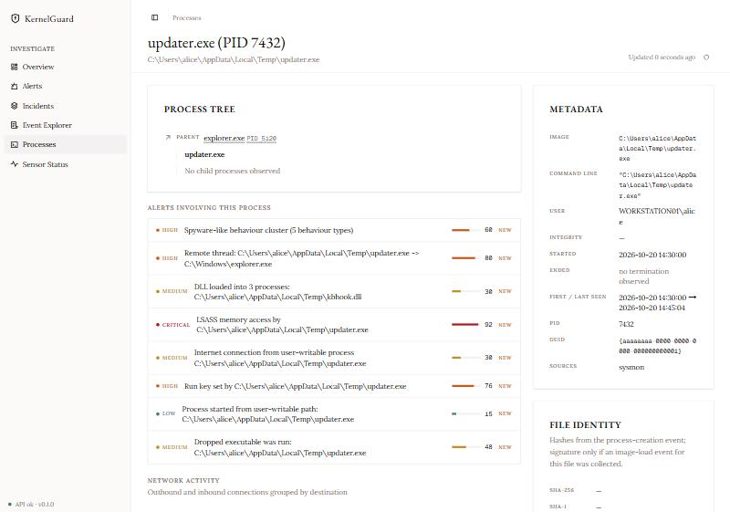
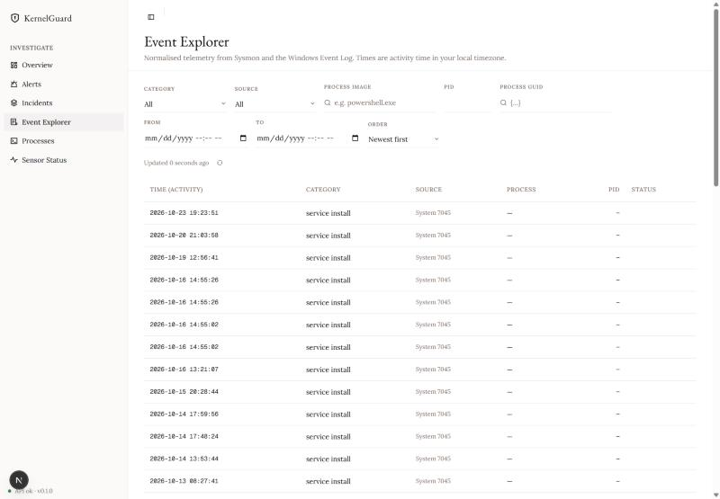
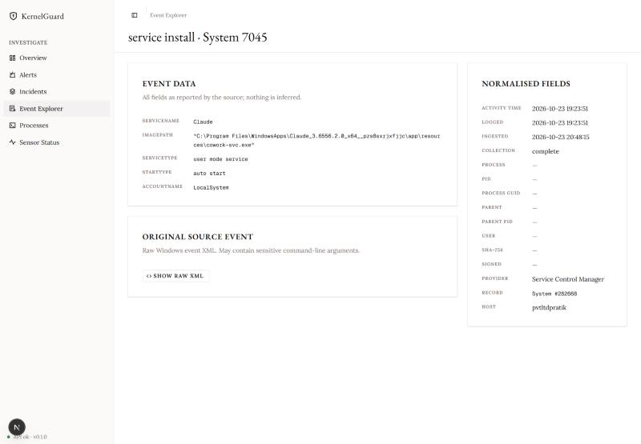
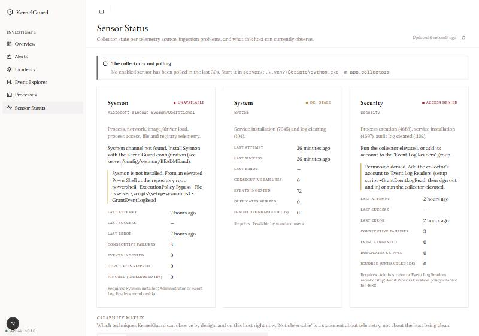
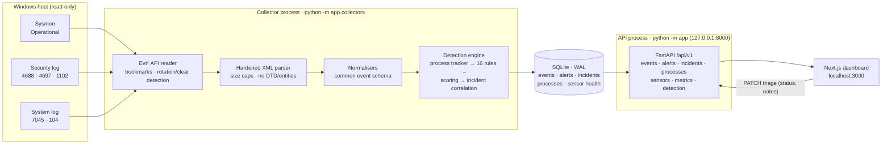

<div align="center">

# 🛡️ KernelGuard

**Windows endpoint threat detection with explainable, evidence-first alerts.**

KernelGuard collects Sysmon and Windows Event Log telemetry, detects persistence, process injection,
credential access and spyware-like behaviour, correlates alerts into incidents, and explains every
score, without claiming more than the evidence shows.




</div>

---

## ✨ Highlights

- **Real telemetry, read-only.** Sysmon, Security (4688/4697/1102) and System (7045/104) via the documented Windows Evt\* API. It never kills processes, deletes files or captures keystrokes.
- **Explainable detections.** Every alert separates **observed** facts (linked to the source event) from **inferred** interpretation, and lists what the evidence *cannot* show.
- **Honest ATT&CK mapping.** Each technique is tagged `observed` (the event *is* the technique) or `consistent_with` (it fits but has other explanations).
- **Incidents, not alert floods.** Alerts that share a process, parent or file within a time window are correlated. Each rule counts once in the score, and false positives contribute zero.
- **Tuned on live data.** On 21.4k real Sysmon events, tuning cut alerts from **1,564 → 9** (99.4%), and every change has a regression test.
- **Capability matrix.** It reports which techniques are observable, partially observable or **not observable** on *this* host, given live sensor health.
- **Robust ingestion.** Durable bookmarks, exactly-once storage, detection of rotated and cleared logs, hardened XML parsing (defusedxml) and bounded retention.

## 📸 Screenshots

| Alerts (demo data) | Alert detail (demo data) |
|---|---|
|  |  |
| **Incident timeline (demo data)** | **Process investigation (demo data)** |
|  |  |
| **Event Explorer (real data)** | **Event detail (real data)** |
|  |  |
| **Sensor Status (real data)** | **Overview (real data)** |
|  |  |

> *Demo data* screenshots use the synthetic attack scenario from the test suite (an `updater.exe` in `%TEMP%`
> that sets a Run key, injects into explorer and opens LSASS). *Real data* screenshots come from a development host.

## 🏗️ Architecture



**Design principles**

| Principle | How |
|---|---|
| Least privilege | Only the collector reads protected logs, using *Event Log Readers* rather than admin. The API is unprivileged and binds to loopback only. |
| Exactly-once storage | Events and their bookmark commit in one transaction. A SHA-256 dedup key (host, channel, record, time, event ID) blocks duplicates. |
| Failure isolation | Detection runs in a SAVEPOINT. An engine fault keeps the events and is counted for `rescan`. |
| PID-reuse safety | Processes are keyed by Sysmon ProcessGuid, or PID + start time. |
| Explainability | Score = (severity + named adjustments) × confidence. Every term is stored and shown. |

```
kernalguard/
├── server/                 FastAPI backend, collectors, detection engine
│   ├── app/collectors/     Evt* reader, XML parser, Sysmon/EventLog normalisers
│   ├── app/detection/      engine, rules/, scoring, correlation, capabilities
│   ├── app/api/            REST routes (/health, /api/v1/*)
│   ├── config/sysmon/      KernelGuard Sysmon configuration
│   ├── migrations/         Alembic migrations
│   ├── scripts/            setup-sysmon.ps1
│   └── tests/              274 tests + synthetic event fixtures
├── client/                 Next.js 16 + shadcn/ui dashboard
├── docs/                   architecture, detection, frontend, operations, security
└── start-kernelguard.bat   one-click launcher
```

## 🚀 Setup guide

### Prerequisites

| Requirement | Version | Check |
|---|---|---|
| Windows | 10 / 11 | `winver` |
| Python | 3.10+ (3.12 recommended) | `python --version` |
| Node.js + npm | 20+ | `node --version` |
| Sysmon | 15.x ([download](https://learn.microsoft.com/sysinternals/downloads/sysmon)) | Optional, but most detections need it |

### 1. Clone

```powershell
git clone <your-repo-url> kernalguard
cd kernalguard
```

### 2. Backend

```powershell
cd server
python -m venv .venv
.\.venv\Scripts\python.exe -m pip install --upgrade pip
.\.venv\Scripts\python.exe -m pip install -r requirements-dev.txt
Copy-Item .env.example .env          # optional; defaults work
.\.venv\Scripts\python.exe -m app.db.migrate
cd ..
```

### 3. Sysmon and log access (elevated PowerShell, once)

Extract Sysmon to `C:\Program Files\sysmon` (or pass `-SysmonPath`). Then, from the repo root in an **Administrator** PowerShell:

```powershell
powershell -ExecutionPolicy Bypass -File .\server\scripts\setup-sysmon.ps1 -GrantEventLogRead
```

The script verifies Microsoft's signature on Sysmon, installs it with `server/config/sysmon/kernelguard-sysmon.xml`, checks both services and the event channel, and adds your account to **Event Log Readers**.

> ⚠️ **Sign out of Windows and back in afterwards.** Group membership only applies to new logons, and locking the screen is not enough.

Optional, for Security 4688 events: enable *Audit Process Creation* (`auditpol /set /subcategory:"Process Creation" /success:enable`).

### 4. Dashboard

```powershell
cd client
npm install
Copy-Item .env.example .env.local    # optional; API defaults to http://127.0.0.1:8000
cd ..
```

### 5. Run

**One click:** double-click `start-kernelguard.bat`. It applies migrations, then opens the API, collector and dashboard in separate windows.

**Or manually** (three terminals):

```powershell
cd server; .\.venv\Scripts\python.exe -m app               # API → http://127.0.0.1:8000/docs
cd server; .\.venv\Scripts\python.exe -m app.collectors    # collector
cd client; npm run dev                                       # dashboard → http://localhost:3000
```

### 6. Verify

```powershell
curl.exe http://127.0.0.1:8000/health                       # {"status":"ok", ...}
cd server; .\.venv\Scripts\python.exe -m pytest             # 274 tests
```

Then open **Sensor Status** in the dashboard. Each sensor should show `ok`.

## 🔎 Detection coverage

| Category | Rules | Example ATT&CK |
|---|---|---|
| Executable / driver | KG-EXEC-001, KG-DRV-001 | — |
| Persistence | KG-PERSIST-001…005 | T1547.001, T1543.003, T1546.012, T1546.003 |
| Injection / credentials | KG-INJ-001, KG-INJ-002, KG-CRED-001 | T1055, T1003.001 |
| Process + network | KG-NET-001, KG-NET-002 | T1059.001, T1218.x |
| Files | KG-FILE-001, KG-FILE-002 | — |
| Spyware-like behaviour | KG-SPY-001, KG-SPY-002 (correlation) | T1056.001 *(consistent_with)* |

**Known gaps (stated plainly):** keylogging via low-level hooks, `GetAsyncKeyState` polling or Raw Input is
**not observable** with Sysmon and the event log. Neither are screen capture, audio capture or kernel rootkits.
See [`docs/detection.md`](docs/detection.md).

## 🛠️ Operations

| Task | Command (in `server/`) |
|---|---|
| Re-run detection after rule changes | `.\.venv\Scripts\python.exe -m app.detection rescan` |
| Online database backup | `.\.venv\Scripts\python.exe -m app.services.backup` |
| Apply migrations | `.\.venv\Scripts\python.exe -m app.db.migrate` |

Troubleshooting, measured performance (about 290 events/s with detection) and Sysmon volume tuning are in
[`docs/operations.md`](docs/operations.md).

## 🔐 Security

The API has **no authentication yet**. It binds to `127.0.0.1` and refuses non-loopback binding unless
`KG_ALLOW_REMOTE_BIND=true`. Don't expose it remotely before adding auth and TLS; see [`docs/security.md`](docs/security.md).

## 📚 Documentation

[Architecture](docs/architecture.md) · [Detection](docs/detection.md) · [Frontend](docs/frontend.md) ·
[Operations](docs/operations.md) · [Security](docs/security.md) · [Sysmon config](server/config/sysmon/README.md)

---

<div align="center"><sub>KernelGuard reports observations and suspected activity. No single alert proves malware is present.</sub></div>
